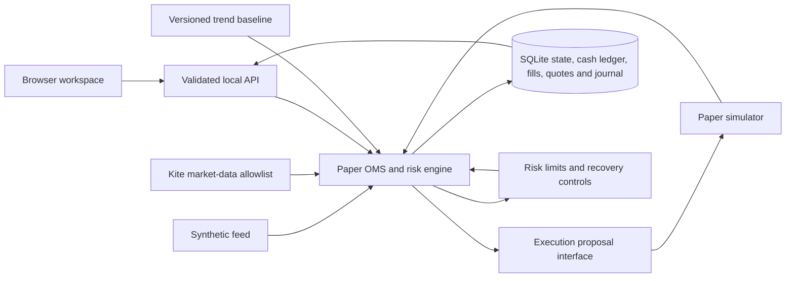
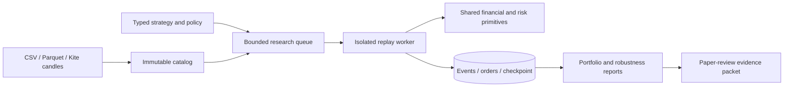
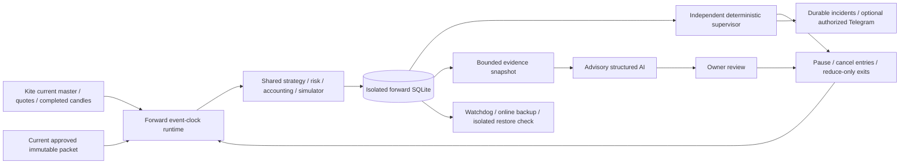

# Architecture: paper desk and historical research

This is a single-user modular application, running as one managed process with isolated SQLite stores. The original paper engine installs and enforces only its simulator. Release 0.7.0 adds a separate disabled-by-default broker pilot, described in the final section and the Phase 5 guide.

## Boundaries

- `app/finance.py`: integer money conversion, tick rounding, estimated charges, European option value/Greeks/IV.
- `app/strategies.py`: pure trend-crossover evaluation, explicit specification and implementation/configuration identities.
- `app/execution.py`: execution proposal protocol and the installed paper adapter. It proposes price/quantity from quotes without performing accounting or network requests.
- `app/engine.py`: paper order lifecycle, idempotency, liquidity reservations, fills, positions, funding, sizing, stress checks, session controls and persistence.
- `app/market.py`: fixed-origin Kite authentication and read-only market endpoints. No generic broker request interface is exposed to API callers.
- `app/api.py`: validated routes, same-origin controls, static delivery, market background loop and browser authentication state.
- `static/`: browser UI. It submits intentions and displays server results. It cannot override sizing/risk outcomes.
- `run.py`: loopback listener, private configuration loading, process ownership and restrictive file permissions.

The engine lock serialises decisions and state transitions. SQLite commits account state, ledger changes, quote observations, fills and journal entries together. Failed actions restore the in-memory state and roll back their database transaction. Broker calls occur outside the engine lock. In-flight quotes are ignored after their source is replaced.

## Money model

Equities/options debit premium or purchase cost from cash; sale proceeds credit cash. Futures reserve estimated margin and debit fees on entry. Futures P&L enters cash through closing fills or estimated daily settlement. NAV includes conservative current liquidation marks, and virtual funding adjustments are excluded from trading P&L.

Partial closes allocate a proportional integer cost basis and preserve any rounding remainder in the remaining position. Fees are recalculated against cumulative executed order turnover so flat brokerage is not charged repeatedly on partial fills. Delivery DP is estimated once per instrument/day.

Pending entries reserve virtual funding and planned loss. A reduce-only exit cannot exceed its position or quantities already reserved by other exits. Protective controls have priority over strategy entries. Daily/weekly drawdown, loss and margin breaches trigger entry halts and simulated exit requests. An unfilled exit stays visible.

## Order states

`OPEN → PARTIAL → FILLED`; an unfilled remainder may become `CANCELLED`. Pre-trade failures become `REJECTED`. Protective stop/target/expiry actions create reduce-only exit orders and retain an audit record. A client identifier uniquely binds a request to its normalised parameters.

## Research and trust

The trend strategy is a deterministic, unvalidated baseline. There is no LLM, automatic strategy generation, learned market probability, online model mutation or performance promise in Phase 1. The risk monitor reports observed account conditions and model estimates. Subsequent AI integrations must use this controlled order boundary and cannot bypass it.

## Explicit ceilings and future work

The state snapshot contains the local order list and is rewritten on each action. This is suitable for focused personal simulations; larger workloads require normalised order/position tables, retention policies, account partitioning and measured capacity tests. SQLite quote retention also needs an operational storage policy before sustained ingestion.

Future live execution requires a separately reviewed broker adapter, actual reconciliation with broker positions, contract and holiday services, real margin calculations, execution uncertainty recovery, stronger authentication and operational validation. A configuration switch is insufficient to enable it.

## Decision and instrument evidence

The OMS inserts immutable application-level decision records with state, fills, ledger and
journal updates in the same SQLite transaction. A failed action rolls back all of them.
Each record captures session, input/portfolio quotes, account/position state, strategy
implementation and configuration identities, risk policy and per-check results, sizing
constraints and simulated execution assumptions. Fills link to orders and acceptance
evidence. Signal evaluations also retain HOLD, warmup and skipped opportunities.

The `decisions` table has a monotonic sequence and indexes by session and order. APIs provide
bounded cursor pagination, individual records and archived-session access. Old activity
retains its original journal without invented decision records. `instrument_history` retains
observed metadata snapshots at initialisation, source changes and new experiments.

`_evaluate` is the single risk calculation boundary for preview, sizing and submissions.
Manual requests and versioned strategy rules both call it. Approved orders obtain execution
proposals from `ExecutionAdapter`; only `PaperExecutionAdapter` can run in this release.
The OMS validates remaining exposure, applies fills and owns accounting. A future broker
adapter will need asynchronous order acknowledgement, uncertainty recovery and broker
reconciliation before the explicit Phase 5 enablement gate can be implemented.

Options monitoring groups independently held legs by underlying, showing per-leg expiry,
liquidity and model Greeks plus combined quantity-weighted exposure. Linked-leg execution
and option writing remain outside the Phase 1 execution model.

`tools/backup.py` uses SQLite online backup and integrity checks. Backup/restart tests run
against separate databases, including committed WAL data, decision evidence and entry pause.
The version locks specify the tested Python 3.13 Linux dependency graphs. See
`product-plan.md` for release criteria and risk/data governance.

## Phase 2 research workspace

`app/research/schemas.py` defines bounded datasets, terms, calendars, dated fees, strategies,
execution assumptions and evaluation windows. `catalog.py` retains raw and normalized
immutable Parquet, provenance and quality checks. PyArrow provides filtered queries.

`signals.py` implements pure/declarative families and training-only ridge evaluation.
`replay.py` owns the event clock, strategy books/FIFO lots, shared capital, order events,
per-leg execution, dated charges, MTM and settlement. Both workspaces share risk/cash-flow
primitives, charges, option calculations, execution proposals and trend rules.

`jobs.py` manages two process workers and per-run SQLite WAL event/order/checkpoint batches,
pause/resume/cancel, build identity and worker leases. `metrics.py` reports performance,
seeded block-bootstrap and search diagnostics. `api.py` and `static/research.js` expose the lab.

See [Phase 2 implementation guide](phase-2.md) for units, state locations, APIs, validation
and limits. The packet does not activate advanced strategies in the original paper desk.
Exact portfolio margin, order-book queues, AI generation and full AI supervision are not
silently claimed as implemented.

## Live breadth feed

`app/live.py` maintains up to three fixed-origin Kite full-mode WebSockets. The cached daily
instrument master supplies every current NSE EQ-type token; selected NFO contracts and
underlying references receive streaming priority. Equities beyond the 9,000-token streaming
allowance receive rotating REST snapshots, with transport and coverage explicitly reported.
Public metadata loads without a price session. A paginated scanner reads the latest
observed quotes. The paper pump consumes only new, fresh executable watchlist quotes, at
most once per second. Its atomic guard rejects data from an obsolete watchlist.

`data/market-data/market.sqlite3` stores feed enablement and bounded, explicit watchlist
captures separately from account accounting. Stopped captures import through the immutable
research catalog, with raw exchange/receipt timestamps and source evidence. No credentials,
order postbacks or broker account events enter that catalog. See [operating guide](live-data.md).

## Phase 3 candidate research

`app/candidates/service.py` owns a separate SQLite registry under `data/strategy-lab/`.
Immutable study protocols and candidate hashes bind data, strategy specifications, model
provenance and evaluation budgets. A nested-savepoint transaction boundary keeps state,
budget and audit events consistent. The local hash chain detects changes but has no external
trust anchor. Main account accounting remains independent.

`provider.py` sends training-only context to a fixed Responses endpoint, without tools,
model-generated-code execution or broker credentials. `schemas.py` and existing research
capability checks validate every proposal. A single bounded provider worker retains failures
and uncertain usage; replay workers strip model and broker keys.

The candidate scheduler submits durable configurations to existing isolated research workers.
Configuration hashes recover dispatch after interruption; build mismatches prevent resume.
Screening uses training/reproduction, validation, cost stress, expanding walk-forward and
stop-distance sensitivity. Finalist selection consumes a holdout by dataset-lineage fingerprint.
Registry review can produce an immutable paper packet; it has no activation or live-order path.
See [operator guide](phase-3.md) for exact contracts and constraints.

## Guided connection onboarding

`app/configuration.py` validates owner-only regular configuration files and atomically replaces
Kite app keys while preserving other recognized settings. File values override matching
environment values at launch. `app/onboarding.py` supplies secret-free status and bounded
quote/history sample checks tied to the current session, without altering the paper account.
`static/onboarding.js` guides app setup, key entry, normal broker login, capability checks and
explicit market/paper-source selection. Credential validation errors are redacted. OAuth state
binds only fixed local return destinations; login failures return safely to the setup page.

## Phase 4 forward supervision

`app/forward/service.py` owns immutable prospective experiments, SQLite checkpoints/hash-chained
financial evidence, registry approval verification, incidents and bounded persistent jobs.
`runtime.py` adapts the shared replay financial/risk primitives to real quote receipt times and
completed candles. Historical warm-up is signal history only. Daily close signals wait for
next-session observations. The original paper desk and historical workers retain separate books.

Candle, warm-up, AI and optional alert workers have independent bounded pools; financial state
mutations remain serialized and atomic. Durable provider reservations/attempts precede calls;
uncertain outcomes require human review rather than blind retries. Advisory AI has no control
or execution authority. The only installed execution adapter remains the paper simulator.

`app/operations.py` exposes systemd readiness/watchdog signals; `deploy/` manages the single
loopback instance and daily backup. `tools/forward_ops.py` includes all relevant databases,
immutable datasets and source archives without credentials. `tools/archive_release.py`
verifies source against the recorded engine build. Local hashes/backups are not externally
anchored or offsite. See [Phase 4 operator guide](phase-4.md) for capacity and qualification limits.

## Dated external inputs (0.6.0)

Official NSE report imports, read-only MoSPI metadata/data requests, RBI RSS and bounded Kite
chain snapshots feed an independent SQLite evidence store. Raw artifacts and their numeric
observations retain source, scope, units, base year, publication precision, receipt, validity
and local hashes. Source jobs run outside financial transactions.

Feature joins enforce publication/receipt cutoffs and create immutable child research datasets.
Forward protocols select named inputs and freeze their source policy. Readiness checks gate
entries; completed-bar signal records and bounded advisory AI context retain evidence ids.
Guardian packets include the selected input snapshot. Source outages cannot grant execution
authority or weaken independent risk. See [the input operator guide](inputs.md).

## Market charts and Phase 5 preparation (0.7.0)

`app/charts.py` stores validated completed Kite candles in an independent persistent chart cache. Its API/UI show historical provenance and work after logout. This cache never supplies executable liquidity.

`app/pilot/` introduces a separate fixed-route broker transport and durable supervised order journal. The deployment capability defaults off; qualification, current guardian evidence, immutable account/capital mandate, reconciliation, session arming and per-order confirmation are distinct gates. Intentions and capital reservations commit before external sends, acknowledgements are reconciled against actual broker orders/trades, and uncertain sends never auto-retry. Original simulation books and market-data allowlists remain independent.

This is Phase 5 preparation for manually confirmed NSE/CNC LIMIT orders. Actual pilot qualification/activation, overnight/GTT broker protection, automated strategy entry dispatch, derivatives and final settlement/fee reconciliation remain pending. See [the exact operating contract](phase-5.md).

## Workspace 0.14 customer flow

The root document is `static/workspace-v014.html`. `shell-v011.js` preserves the paper engine UI actions while `workspace-v011.js` owns guided Home, persistent watchlists, the chart desk, visual option/rule editing and explicit test handoffs. TradingView Lightweight Charts 5.2.1 is bundled locally with its license and notice; completed broker candle cache and latest quotes remain separate.

`app/workbench/` provides strict schemas, the 51 signed-leg recipe catalog, pure payoff/model analytics, immutable draft revisions and saved chain observations through `/api/workspace`. It never owns broker execution. Historical handoffs require explicit dataset identity/mapping; forward handoffs require current master contract identity and create paused REFERENCE books through the existing independent forward service. `data/workspace/workspace.sqlite3` is included in all-store backup and draft/chain hash verification. Price scenarios and model statistics carry no execution or approval authority. See [the customer guide and boundaries](workspace-guide.md).

Named watchlists are a mutable bounded settings collection in the workspace store, migrated from the earlier single list on first save. SSE snapshots use cached master identities and read only the requested quote subset, without provider requests or consuming dirty execution quotes. `MarketHub` prioritizes the union of display, paper and forward subscriptions within existing provider connection limits. Accepted broker observations feed bounded `DisplayBars`; these bars and the LTP line never enter historical, research or execution stores. The browser merges display bars by timestamp with authoritative completed candles and labels partial coverage and data age.

`app/portfolio.py` derives display rows and integer-paise summaries from the existing broker snapshot without modifying it. `static/portfolio-v011.js` and `portfolio.css` implement the separate holdings/positions/paper views, sorting, filters, details and explicit CSV export. Entering the portfolio defaults to broker holdings without changing the selected execution account. Broker snapshots remain private runtime data, excluded from source archives and published validation artifacts.

The pilot retains an independent `portfolio_snapshot` display cache bound to the latest audited reconciliation hash. Restart clears execution reconciliation and arming, while preserving the separately validated display. The scoped recovery operator can restore only display data from a verified backup matching the current audit anchor; it never restores execution reconciliation, sessions, orders, account balances or authority.

Manual trading authority uses `ManualMandate` at `/api/pilot/manual/mandate`. It shares integer-paise risk checks, capital reservations, broker reconciliation and protective exits with the existing execution service. It has no forward portfolio binding and cannot claim or confer strategy qualification. The reviewed calendar has a fixed expiry and rejects special sessions. The status readiness contract uses only local evidence; no GET places, cancels or reads broker orders. `tools/enable_manual_transport.py` installs the reviewed systemd connection capability only after exact-source validation, deployment, consistent backups and verification of an empty inactive broker journal; failure restores the previous capability configuration. See [manual trading](manual-trading.md).

`app/pilot/onboarding.py` supplies a side-effect-free draft preflight at `/api/pilot/manual/review`; manual authority saving reuses its funding/permission/risk checks. `trading-onboarding-v014.js` owns four-stage client navigation, inline errors, review invalidation, request-time form locking and saved-authority hydration. Setup verification remains valid for the current authenticated session/day, whereas execution readiness still independently requires a fresh 15-second reconciliation. The owner-confirmed external whitelist/delivery actions never become API-verified claims.

Manual authority records an explicit SELECTED or ALL_NSE_EQ instrument_scope in the audited mandate. `app/pilot/universe.py` centralizes current NSE one-unit equity eligibility and the saved-universe label. All scope applies to manual authority only, and missing legacy fields retain selected-symbol behavior. Onboarding and actual execution independently validate membership while all reservations and risk budgets remain global to the account.

`app/pilot/limits.py` distinguishes explicit BROKER_FUNDS authority from CUSTOM/legacy limits. Broker-funded mandates store null budget fields, skip only app-defined financial/count budgets, and keep the shared cash/fee/reservation, authentication, quote, order-journal and protection pipeline. Policy is included in the immutable mandate hash and every preview binds that hash. Strategy-linked mandates retain independent reviewed forward allocation/risk checks. The frontend defaults new drafts to broker funding, preserves stored custom policies, and invalidates review on policy changes.

## Strategy studio · 0.15

`app/workbench/studio.py` handles analysis-only adjustments, cached position selection, read-only margins and immutable strategy quote marks in the workspace SQLite store. New optional leg/manual-P&L fields preserve legacy draft hashes. Backend and paper handoffs exclude disabled legs. The broker allowlist distinguishes the JSON POST basket-margin calculation from write-enabled order routes. Mark histories and recorded chain-series reads verify hashes; restore checks cover marks. No new derivative execution authority or background broker request is introduced; quote auto-refresh is an explicit visible-browser choice.

## Single-view builder presentation · 0.16

`builder-layout-v016.js` arranges the existing controls into a shared leg/analysis workspace without duplicating analysis state. `workspace-v016.js` supplies compact editors and a chain that retains payoff context; `strategy-studio-v016.js` retains the existing analysis and read-only broker operations. Calculations and execution authority are unchanged. Browser acceptance measures the full four-leg overview at 1366×768, including calculated fixture margin, and validates mobile overflow, saved drafts and moved controls.

## Template library · 0.18

`templates.catalog()` adds pure structure metadata and normalized payoff profiles from each signed recipe. The browser renders those points as SVG and applies visible market-view buttons and search without altering the active analysis basket. Single-expiry miniatures use intrinsic payoff; multi-expiry miniatures use the shared option model at the first expiry. No market request, account mutation or new execution path is introduced by catalog filtering or preview generation.

## Navigation disclosures · 0.19

The versioned navigation controller manages temporary sidebar and More tools disclosures over the existing shell routes. The compact rail reserves 64px on every view; expanded panels use overlays without shifting charts. Navigation and dismissal reset both disclosures. No account, broker or strategy state is modified.

## Contract stepping · 0.20

The read-only contract-grid API returns scoped instrument-master strike, expiry, lot and tick terms without quote or order calls. The builder uses this grid for adjacent-contract selection and premium steps. Metadata remains outside immutable baskets. Cached matching chain observations can reprice a selected contract; unavailable prices retain explicit manual entry assumptions. Hypothetical strike spacing remains a model input.
