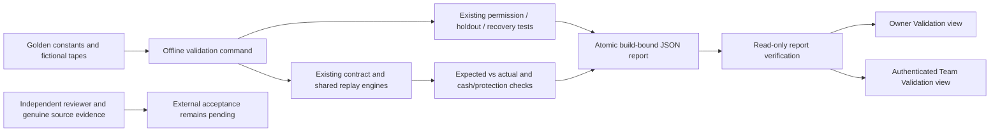

# MVP-4: financial validation and acceptance evidence

This implements the fourth stage of the [five-stage MVP roadmap](../mvp-validation-roadmap.md).
It is separate from engineering Phase 4 forward-paper monitoring. Current measured results
belong in [validation.json](validation.json), [implementation.json](implementation.json),
[workspace validation](../workspace-validation.json) and the
[desktop/mobile browser record](../financial-validation-browser.json).

Engineering implemented and deployed 2026-11-07. Actual checks passed: 640 automated tests, 33 controlled financial cases, ten focused boundary gates, fourteen browser suites and both general/MVP-4 read-only deployed checks. Pre/post backups each covered 30 databases and passed isolated restore verification.

Engineering checks and external acceptance have distinct outcomes. A controlled pass does
not complete MVP-4 independent financial acceptance. An independent qualified reviewer,
genuine-data calibration and the outstanding customer/source/deployment dependencies are
still required. No reviewer identity, review signature, genuine quote, broker fill or
customer acceptance is generated by this implementation.

## User journey

Open **Strategy Contracts → Validation** in the owner workspace, or sign in to the
separate **Team workspace → Validation**. All active team roles can inspect the same
build's controlled software results. Anonymous team API access is rejected.

1. Read the recorded date and status. `Not run`, `Evidence invalid`, `Earlier build`,
   `Checks need attention` and `Controlled checks passed` are separate states.
2. Review the sample sizes, clean-control failures and missed faulty controls.
   These rates describe a finite authored case set, not a market-wide false-alert rate.
3. Filter by category or failed result. Expand a case to inspect its independently
   pinned expectation, actual output and derivation. Money is integer paise; ₹1 = 100 paise.
4. Review the permission, recovery and information-boundary regression gates.
5. Download the exact JSON report for review. Its local hash checks consistency;
   it is not a signature or an external source attestation.
6. Keep the external-acceptance items open until actual dated evidence is available.

The page is read-only. Refresh reads recorded evidence. It does not run tests on a web
worker, import examples, create research trials, change account balances or grant scopes.
Existing MVP-1/2/3 and other workspace views remain available.

## Operator workflow

Before source changes, archive the existing build using the repository's established tool.
Then run from the project root:

```bash
.venv/bin/python -B tools/validate_financial.py
.venv/bin/python -B tools/validate_workbench.py
```

The first command runs the golden cases and ten focused existing regression gates.
The second runs the full unit suite, the financial validator, fourteen browser suites,
dependency checks and JavaScript syntax checks. Use the generated records for actual
counts. Browser checks require the installed Playwright Chromium environment.

The financial runner uses private temporary directories and isolated research/catalog/
workspace databases. It does not read production accounts or `.env.local`, and it never
constructs a broker or AI provider client. Subprocess gates remove configured provider and
broker credential variables. Each case failure is retained; an exception is a failed case,
including for a faulty control, rather than evidence that the defect was detected.

Expected monetary outputs are literal constants with algebraic rationales. They are not
generated from the tested payoff, fee or replay output. The separate cash check recomputes
signed cash movements from actual fills and fees, then compares them with the engine cash
delta. Protection is checked after every committed fill, including partial exits.

The golden execution policy is an explicit fictional fixture policy, including sufficient
capital/risk/margin headroom. It neither changes user risk settings nor calibrates broker
margin. The engine still uses its declared conservative gross-margin approximation.

## Architecture and boundaries



- `app/validation/benchmark.py`: fixed expected values, labeled cases and isolated execution.
- `app/validation/evidence.py`: read-only hash, case inventory, summary, gate and source checks.
- `tools/validate_financial.py`: offline orchestration and atomic report publication.
- `static/team/validation.js` and `.css`: shared desktop/mobile presentation with safe text escaping.
- `GET /api/contract-research/validation`: local-owner evidence view; `/validation/export`
  downloads the verified report while preserving JSON numeric types and its hash.
- `GET /api/team/validation`: session-authenticated team evidence view; its `/validation/export`
  route has the same authentication requirement.
- `tests/test_financial_validation.py`: financial goldens, mutation sensitivity, report
  corruption/staleness and API trust boundaries.
- `tools/financial_validation_browser.py`: isolated owner/team user journeys and downloads.

Reports bind the full source/asset/test/tool/lock fingerprint and the research build.
Changing any covered file makes old evidence stale. A changed case catalog also invalidates
the old claim. The reader recomputes case pass flags, summary totals and the required gate
inventory; recomputing an envelope hash cannot conceal a contradictory result. A current
server build must also match, so an old process cannot claim the changed on-disk build.
The recorded report is not stored in an account database or copied into economic protocols;
old studies and packets retain their existing immutable build identities.

The runner records actual failures with nonzero exit status. Source changes during a run
abort publication. Normal completion atomically replaces the latest report, including a
failed report. Interrupted runs leave the last completed record; inspect its timestamp.
Historical source archives retain prior builds. The latest report is a software validation
artifact, not an immutable customer research packet or permission grant.

## Acceptance cases and limitations

The executable inventory includes call/put debit spreads, a call credit spread, an iron
condor, multiple lots, explicit costs, independently calculated charge components, dated
fees/lot terms, partial short buybacks, latency, deliberately rejected legs, stale/wide/
zero-depth observations, incomplete entries, unavailable exits, delayed receipts, impossible
receipt clocks, expiry boundaries, exposed holdouts and tampered/reproduced economic evidence.
See each report case for the exact fixture and expected result.

The rejected-leg case uses the existing shared-engine sensitivity setting in an isolated
execution-layer run; it is not a new user-facing protocol or broker rejection experiment.
Partial exits retain hedges until all corresponding shorts close. Missing exits retain real
simulated exposure; case success never means the stranded book is safe or flat.

The ten focused regression gates reuse actual holdout, code-injection, cancellation,
authenticated-review, revocation, expiry, cross-organization and restored-scope tests.
Full-suite validation provides broader regressions. A financial output mutation test proves
that a one-paisa payoff error fails a golden case; it is not a universal mutation-coverage claim.

Actual provider calibration is intentionally unverified. The hypothetical fee schedule is
not today's exchange/broker tariff. Dated market schedules, complete quote provenance,
order-level versus contract-note rounding, exchange queue, market impact and actual margin
must be reviewed against a supplied genuine dataset. Historical candles cannot establish
historical executable bid/ask depth or first receipt times.

Primary references checked for defining those external checks:

- [Kite quotes and instrument metadata](https://kite.trade/docs/connect/v3/market-quotes/).
- [Kite historical candle fields](https://kite.trade/docs/connect/v3/historical/).
- [Kite streaming timestamps and depth](https://kite.trade/docs/connect/v3/websocket/).
- [Zerodha charge categories](https://zerodha.com/charges).
- [Zerodha STT effective-date guidance](https://support.zerodha.com/category/account-opening/resident-individual/ri-charges/articles/how-is-the-securities-transaction-tax-stt-calculated).
- [NSE contract-adjustment circular](https://nsearchives.nseindia.com/content/circulars/FAOP68130.pdf).

The MVP team product does not offer AI explanations in this stage. Existing candidate AI
and forward-monitor provider gates remain unchanged. A future explanation offering must
retain deterministic checks and record actual configured-provider responses separately.

## Independent acceptance handoff

Use [reviewer-checklist.md](reviewer-checklist.md) to collect actual reviewer and calibration
evidence. The app does not treat an uploaded declaration or a distinct account as proof of
quantitative independence. External statuses remain pending in this release. Existing
MVP-3 real off-host delivery/restore, customer TLS and source/customer acceptance requirements
carry forward. MVP-5 customer operation remains a separate stage.
