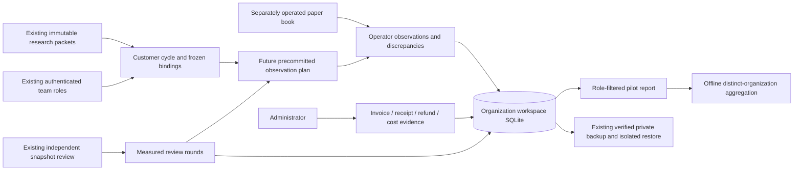

# MVP-5: early-customer operation and measured value

MVP-5 adds **Team workspace → Customer pilot** for the fifth stage of the
[B2B MVP roadmap](../mvp-validation-roadmap.md). It is separate from engineering
Phase 5 broker trading. Actual release, test and deployment results belong in
[implementation.json](implementation.json), [workspace validation](../workspace-validation.json),
[controlled browser evidence](../customer-browser-validation.json) and
[deployed read-only evidence](deployed-smoke.json).

Engineering implemented and deployed 2026-11-07. Actual final validation passed 669 automated tests (29 new customer-operation cases), 33 financial goldens, ten boundary gates, fifteen isolated browser suites and 34 general/MVP-5 read-only deployed checks. Pre/post backups each covered 30 databases and passed isolated restore verification.

This is software for operating and measuring early-customer work. Customer adoption,
payments, renewals and four weeks of real operation cannot be manufactured by implementing
it. No production customers, invoices, receipts or examples are installed automatically.
MVP-4 independent financial/data acceptance and the earlier customer/source, off-host
recovery and public team-host dependencies remain open.

## End-to-end workflow

1. Initialize the organization and invite an independent reviewer using the
   [existing team setup](../mvp-3/README.md). Each customer organization has its own store,
   deployment and identities. Do not publish the local-owner application as a customer host.
2. An administrator creates a pilot engagement with a customer workflow reference,
   measured baseline review duration and its evidence reference. Choose **Controlled
   exercise** for demonstrations. **Customer-reported** is an operator declaration, not
   independently verified customer identity or acceptance. The evidence kind is immutable;
   do not relabel an exercise as real traction.
3. Use **Research** to import supported data/definitions, freeze a protocol, run the
   evaluation and capture an immutable packet. A researcher creates a customer cycle from
   a current packet and records the customer's actual question. The cycle pins the exact
   packet, protocol, definition, dataset, build, policy and contributor identities.
   Reusing the same packet in another cycle is rejected.
4. An eligible independent reviewer starts the timer, opens **Reviews & scopes**, and
   records the snapshot decision using the existing authenticated review system. Return
   to Customer pilot, select that decision and finish the timer. The timer uses server
   elapsed wall time, including idle. Additional review rounds accumulate in the same
   cycle; they do not create another baseline sample or conceal extra review effort.
   A review cannot be timed twice. Abandon an interrupted timer explicitly.
5. For prospective observation, prepare a future-dated fixed-contract protocol with only
   seed observations already available at planning time, capture/review its evidence, and
   measure the accepting review. A researcher then freezes an observation plan referencing
   the separately operated paper book. The plan uses the exact strategy entry and protocol
   cutoff; its creation must precede entry. Seed data containing future observations are
   rejected. Stale/insufficient seed data remain unqualified research, not a successful
   financial evaluation.
6. Once that interval actually starts, append timestamped observations with source/evidence
   references. Record source gaps, execution differences and material changes explicitly.
   Reported P&L is optional and labeled operator supplied, never engine verified.
   A separate reviewer can confirm or reject a documented discrepancy with their own
   rationale/reference. Neither action rewrites the original observation.
7. A material change ends that plan. An `ENDED` observation must describe the end of the
   actual planned interval; it cannot be recorded before the cutoff. New financial inputs,
   changed builds, recovered organizations or superseded acceptance require newly reviewed
   work. Existing records remain available as history.
8. Record onboarding, support and active review effort separately, in minutes with a work
   reference. Active effort is self-reported and distinct from the elapsed review timer.
   It does not create a monetary cost automatically.
9. Administrators record actual invoice, payment, refund and delivery-cost evidence.
   Record a renewal by linking a subsequent invoice period to its predecessor. Both periods
   must be fully paid, net of refunds, before a renewal contributes to the report.
10. Download the pilot report and inspect paired review durations, completed customer-reported
    journeys, discrepancies, effort and recorded economics. Repeat the workflow on actual work.
    Record integration needs with a stable key and customer evidence; use distinct-organization
    cohort reports to decide what merits another integration.

## Prospective observation scope

The new prospective component is a **precommitted observation journal**. It references a
paper book already operated under its own approved execution path. It does not start a
forward worker, ingest a broker feed, calculate fills or P&L, or grant execution permission.
Existing paper research, forward books, risk checks and broker gates retain their original
boundaries. A snapshot acceptance and an observation plan do not expand an existing
`BOUNDED_PAPER_RESEARCH_ONLY` scope into forward or broker authority.

This distinction is visible in the UI, stored plan authority and exports. It supports the
MVP-5 operating/measurement loop while preserving genuine provider and financial acceptance
requirements. A native customer feed or forward adapter is a separate integration decision,
to be justified by repeated customer demand rather than inferred from this journal.

Observation timestamps cannot be future-dated or precede the frozen start, and entries
must be chronological. Ordinary observations must stay within the frozen interval. End
records may be supplied later, but activity is capped at the original end. Records received
more than 24 hours after their stated observation time are retained as `LATE_RECORDED` and
excluded from activity-span/week metrics. Uploading late history cannot manufacture four
weeks of prospective use. Server receipt, stated observation and plan clocks remain visible.
These clock checks do not independently authenticate an external paper book or data source.

## Commercial records and corrections

All money is stored as integer paise. These controls record evidence; they do not issue
invoices, collect payments, refund a bank account or contact any provider. A unique event/document journal
reference prevents the same commercial event from being imported twice under a new request
ID. Retries of the same request reuse the original record.

Payments cannot exceed the invoice balance. Refunds cannot exceed recorded net receipts.
Voiding requires an unpaid or fully refunded invoice. Renewal periods must follow the
preceding period of the same engagement. Costs retain explicit DATA / MODEL / COMPUTE /
REVIEW / SUPPORT / OTHER categories and references.

Use **Correct an erroneous receipt, refund or cost entry** to reverse a bookkeeping mistake.
This appends an auditable correction and retains the original entry; it records no actual
money movement. A genuine refund is a separate REFUND record. Dependent entries must be
corrected in an order that keeps invoice receipts within their bounds. A record cannot be
corrected twice. Record a corrected replacement under a new unique journal reference, linking
the original source evidence and correction rationale. Costs and receipt corrections update current summaries without altering
old report downloads or the underlying event history.

Commercial records and monetary aggregates are administrator-only, including API responses
and exports. Other authenticated members see research/observation/effort evidence and a
redacted report. The legacy team dashboard does not expose the commercial ledger.

Net receipts are payments minus refunds. Net cash after recorded costs subtracts only
recorded delivery costs; it is not accrual profit or evidence of complete cost coverage.
Cost completeness remains explicitly UNVERIFIED. Missing costs, baseline/customer references,
actual payment proof and contractual source acceptance still need external review.

## Metrics and cohort reports

The dashboard excludes CONTROLLED_EXERCISE engagements from all customer traction,
commercial, effort and integration-demand metrics. Exercises retain their actual records
for inspection. No signup, login, polling request or page refresh counts as a journey.

Paired time comparisons use one frozen baseline per measured cycle and the sum of every
finished review round for that cycle. The report publishes sample counts, round counts,
baseline median, elapsed median and percentage reduction, including negative reductions.
Baselines are supplied evidence; elapsed times include idle and do not assert active effort.

A completed customer-reported journey requires a measured review and an ended precommitted
observation interval. Repeated four-week usage requires at least two such cycles, an
on-time observation span of at least 28 elapsed days, and activity in at least four UTC ISO
weeks. Registration age alone and late records do not qualify. Reported gaps and their
independent assessments remain separate from proof of trading profitability or losses saved.

One organization contributes at most one paying/renewed/repeated-use outcome, regardless
of how many engagements or invoices it holds. Fully paid invoices and paid renewals are
recomputed net of refunds, voids and entry corrections. Download administrator reports
from each explicitly selected customer organization, then run:

```bash
.venv/bin/python -B tools/customer_cohort.py /private/customer-a.json /private/customer-b.json
```

The tool does not search stores, contact customers or choose recipients. It checks JSON
hashes, schema/scope, types, cash reconciliation, elapsed-use consistency and duplicate
organization identities. It rejects future-dated exports and non-administrator reports.
Its output is JSON; shell redirection may save it to an operator-chosen private file.
The authored experiment targets are reported separately from observed counts:

- Five paying organizations.
- Three renewed organizations.
- Four organizations with repeated four-week activity.
- At least four organizations with two or more measured reviews and a median review-time
  reduction of at least 50% across their per-organization comparisons.

Integration demand counts distinct organizations, not repeated requests from one team.
Hashes establish local consistency, not customer identity, invoice authenticity or payment
settlement. These reports always retain `mvp5_accepted=false` and the external acceptance
requirements, even if an operator-reported target is reached.

## API contracts

The [generated request contracts](api-contracts.json) reflect the installed strict models.
Authenticated endpoints are:

| Method | Path below `/api/team/customer` | Purpose |
|---|---|---|
| GET | `/dashboard` | Role-filtered records, choices and summary |
| GET | `/report` | Exact, role-filtered JSON report download |
| POST | `/engagements` | Administrator intake and baseline |
| POST | `/cycles` | Researcher binds a current immutable packet |
| POST | `/timers` | Independent reviewer starts/finishes/abandons a round |
| POST | `/plans` | Researcher freezes a future observation journal |
| POST | `/observations` | Researcher appends observed evidence |
| POST | `/corrections` | Another reviewer assesses a discrepancy |
| POST | `/effort` | Member records actual effort and reference |
| POST | `/finance` | Administrator records commercial evidence/corrections |
| POST | `/demand` | Member documents a customer integration need |

Mutations require the existing authenticated cookie, same-origin client header and session
CSRF token. Unknown fields and malformed inputs are rejected without returning submitted
values. Every mutation has a client request ID; reuse it for an uncertain retry with the
same inputs. A changed request body under that ID is rejected. JSON report downloads retain
the original numeric types and report hash.

## Architecture and recovery



- `app/team/customer.py`: strict request contracts, append-only records, request idempotency,
  role enforcement, time/binding checks, commercial arithmetic and reports.
- `app/team/customer_cohort.py`: data-only distinct-organization aggregation.
- `static/team/customer.{js,css}`: Customer pilot UI, safe text rendering, pending-write
  protection, role-specific forms, desktop/mobile layout and exact JSON downloads.
- `tools/customer_cohort.py`: offline report aggregation.
- `tests/test_customer_operations.py`: financial/identity/time/retry/recovery boundaries.
- `tools/customer_browser.py`: two independent sessions and controlled end-to-end UX.

Records, requests and a locally hash-linked event chain live in new `team_customer_*`
tables in the existing organization workspace database. A single cross-process team lock
serializes mutation and consistent backup. Record/request/event insertion commits in one
SQLite transaction. Existing tables and immutable research data are preserved.

All customer operations are session-authenticated `/api/team/customer/*` routes and retain
same-origin/CSRF checks and redacted validation errors. There is no public customer-data
route, default engagement, automatic customer email or external billing connection.
Sensitive commercial data stay in the private organization directory and its protected
backups. The legacy local-owner account and broker stores are not exposed to team users.

The existing backup tools validate the customer record/request/event inventory and include
all tables. An isolated restore preserves history and increments the organization generation;
old observation plans cannot accept new entries. Source archives retain referenced engine
builds. Starting the service does not resume a journal worker because this feature has none;
all observations require explicit authenticated submissions.

The initial operating capacity is 200 engagements and 10,000 journal records per organization.
The app rejects new entries at capacity rather than silently truncating analytical counts.
Plan a separately reviewed archive/retention change before exceeding those limits. A report
is a dated summary of current records; retain exported copies for historical comparison.

## Validation and remaining acceptance

From the project root:

```bash
.venv/bin/python -m pytest -q tests/test_customer_operations.py
.venv/bin/python -B tools/customer_browser.py
.venv/bin/python -B tools/validate_workbench.py
```

The complete release validator includes the MVP-4 financial benchmark, all unit regressions,
fifteen isolated browser suites, dependency checks and JavaScript syntax checks. The new
browser uses temporary organization stores, fictional accounts/invoices and explicit test
clock changes. It proves software behavior, not genuine elapsed customer operation. It
also proves that its advanced fixture clock is rejected by the real-clock cohort importer.
Separate actual-clock tests exercise successful controlled-report CLI aggregation.

Actual customer sessions, externally verified payments/renewals, four weeks of observed
use, costs, customer acceptance and independent financial/source/deployment evidence remain
unperformed until real operators supply them. The proposed commercial targets do not
establish product-market fit or funding. These conditions cannot be satisfied by test
accounts, generated artifacts or an operator changing a clock.
