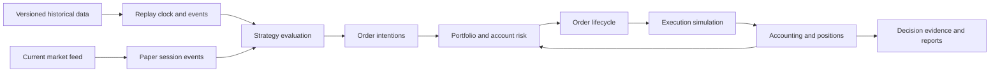

# Phase 2 plan: research and portfolio simulation

**Recorded:** 2026-11-04  
**Status:** Planning baseline retained; implementation and owner validation handoff are recorded in [phase-2.md](phase-2.md).  
**Purpose:** Preserve the complete Phase 2 plan discussed with the project owner so future agents can continue without the original conversation.  
**Real-money trading:** Disabled throughout Phase 2.

## Project context and owner direction

The product is an AI-based trading platform for stocks, stock swing/positional trading,
futures and options. Its longer-term capabilities include algorithmic trading,
AI-generated algorithms, and continuous AI-assisted monitoring of trading workflows.

The owner clarified that the budget is flexible ("budget can be anything") and the
architecture should support all kinds of strategies. These are product-planning
constraints, not authorization to buy data or services, spend money, or enable live orders.
Development budget and trading-account capital are separate quantities.

The initial market assumption is Indian stocks and derivatives, with Zerodha as the first
broker connection. The owner has not explicitly confirmed the final exchange universe.
Keep additional markets and brokers extensible. The account sizes, data suppliers,
subscriptions, exact historical coverage and deployment capacity remain to be selected.

Phase 2 should build the research and portfolio simulation foundation that future AI will
use to judge strategies. It must answer: **Does this strategy still make sense after
realistic costs, execution constraints, capital requirements, and adverse market conditions?**

A flexible budget makes better data, specialist review and parallel development possible.
Broad strategy support must use explicit capabilities: each family qualifies against its
own data, accounting and simulation requirements. Do not interpret broad support as proof
that every strategy can be evaluated with the same dataset or execution model.

Related documents:

- [Product charter, roadmap and governance](product-plan.md)
- [Current architecture](architecture.md)
- [Phase 1 delivery record and validation limits](phase-1.md)
- [Project README](../README.md)
- [Agent entry point](../AGENTS.md)

The roadmap remains: Phase 2 historical research and improved simulation; Phase 3 AI
candidate creation/evaluation and strategy registry; Phase 4 forward paper supervision,
expanded stress testing and recovery qualification; Phase 5 an explicitly enabled limited
live pilot; Phase 6 evidence-supported expansion.

## 1. Define the strategy universe explicitly

Supporting all strategies requires more than adding indicators. Different strategies
need different market information, execution behavior and accounting.

| Strategy family | Phase 2 capability | Essential requirements |
|---|---|---|
| Stock swing and positional trading | Trend, momentum, breakout, mean reversion, rotation | Corporate actions, historical universes, overnight gaps, delivery accounting |
| Stock intraday trading | Opening range, intraday trend, mean reversion | Intraday data, product-specific charges, session and square-off rules |
| Futures | Directional, hedging, calendar spreads, relative value | Individual contracts, rollovers, settlement prices, margin and daily MTM |
| Options buying | Directional, event-driven, volatility strategies | Expired contracts, historical quotes, expiry selection, liquidity |
| Options combinations | Verticals, straddles, strangles, butterflies, condors, calendars, diagonals | Leg relationships, asynchronous fills, portfolio margin, expiry behavior |
| Options selling | Covered, hedged and uncovered structures | Capital and margin history, nonlinear losses, delivery obligations, liquidation scenarios |
| Portfolio strategies | Allocation, rebalancing, overlays, hedging, pairs | Shared capital, correlated exposure, attribution and netting |
| Statistical and ML strategies | Feature-based signals, forecasts, ranking, regime models | Data available at decision time, controlled training and evaluation |
| Market making and latency-sensitive strategies | Specialized research capability | Suitable order-book history, latency and queue simulation, execution infrastructure |

Each strategy declares its required capabilities. The platform reports whether they are
met before running or qualifying it. A candle-based test cannot establish realistic
queue-sensitive execution. A family remains conditional when a dependency is missing;
there must be no silent downgrade to an unsuitable simulation. Uncovered options require
their own margin, settlement and tail-loss validation before that capability is enabled.
Order-book-sensitive strategies need a separate fidelity and infrastructure estimate.

## 2. Expand the current foundation before adding a backtest screen

Phase 1 provides useful paper-trading components. The broader product requires these
extensions; they are planned work, not claims about current functionality.

| Current implementation | Required Phase 2 expansion |
|---|---|
| One trend-crossover implementation | Strategy interface supporting different signals, horizons, instruments and position management |
| One position per instrument, with restrictions on additional entries | Separate strategy books, position lots, pyramiding and partial exits, with account-level net exposure |
| Wall-clock calls inside freshness and session checks | An injected clock supporting historical replay and current market operation |
| Current fee estimates and illustrative margin percentages | Rules with effective dates for charges, margin, sessions, contracts and settlement |
| Synchronous top-of-book fill proposals | Order events supporting acknowledgement, delay, partial execution, rejection and cancellation races |
| Current instrument snapshots | Historical security and contract identities, including expired and delisted instruments |
| SQLite account snapshots | Separate research jobs, historical datasets and run artifacts, with controlled migration of transactional records |

Two strategies may hold the same stock, use different stops and have different horizons.
Their results must remain attributable while combined exposure and capital consumption
are controlled. Establish explicit attribution and account-netting policies.

Relevant source foundations are `app/engine.py`, `app/execution.py`,
`app/strategies.py`, `app/finance.py` and `app/market.py`. Inspect current code before
implementation; the table describes the repository at the planning date.

## 3. Make historical data a first-class product component

Historical data is the first major dependency.

Kite documents historical candles and daily continuous futures history. Its current
instrument master only returns live contracts, and Zerodha states that expired options
history is unavailable through Kite. Broad options research therefore needs another source
of historical contracts and prices. Verify provider capabilities again during selection.

Sources:

- [Kite historical-data documentation](https://kite.trade/docs/connect/v3/historical/)
- [Zerodha expired-contract guidance](https://support.zerodha.com/category/trading-and-markets/charts-and-orders/charts/articles/historical-data-for-expired-f-o-contract)

Procure and validate:

- **Stocks:** daily and intraday prices, volume, corporate actions, symbol changes,
  listing/delisting history and historical universe membership.
- **Futures:** individual expired contracts, contract specifications, settlement prices,
  volume, open interest and rollover information.
- **Options:** expired chains, strikes and expiries available at each historical date,
  bid/ask observations where available, trades, volume, open interest and underlying prices.
- **Reference data:** exchange calendars, contract-size changes, expiry changes,
  applicable charges and margin information.
- **Event and fundamental data:** original publication timestamps and revisions whenever
  a strategy uses those inputs.

NSE offers historical order and trade products. Verify suitability, coverage and usage
rights against sample files before selecting a supplier:
[NSE historical-data products](https://www.nseindia.com/static/market-data/eod-historical-data-subscription).

Retain immutable raw files, validated datasets, correction history and dataset versions.
Distinguish missing observations from genuine trading halts and instruments with no trades.
Use security and contract identities that survive symbol changes and expiry; broker tokens
must not be treated as permanent historical identities.

For options, model-generated premiums can support scenario analysis. Historical
profitability claims must identify when actual option-price evidence is absent. Do not
substitute a synthetic options series and label it validated historical execution.

## 4. Build one deterministic trading core for replay and paper operation

Strategies receive an explicit context: information available at that time, positions,
capital allocation and permitted actions. They submit order intentions through the
controlled boundary. Share strategy rules, risk calculations, order lifecycle and accounting
between historical replay and current paper operation; avoid separate implementations that
disagree on their economics.

Replay requirements:

- A strategy cannot read future observations.
- A signal calculated from a completed candle can act only at the next eligible
  execution event.
- Strategies competing for capital at the same timestamp follow a documented,
  deterministic allocation policy.
- Random simulation assumptions use recorded seeds.
- Repeated runs reproduce economic results and decision paths. Canonical comparison
  should distinguish run-created wall-clock metadata from economic outputs.
- Jobs can checkpoint, resume and cancel without changing the paper account.

For example, a swing signal calculated after the closing candle encounters the next
session's executable price, including an overnight gap.

Recommended architecture: a modular Python application, separate research workers,
immutable Parquet datasets, a query layer and a transactional database for jobs, accounts
and experiment metadata. Run backtests outside web requests and use isolated accounts.
Choose transactional migration and concurrency mechanisms from measured workloads.
Preserve existing account and audit data during any migration.

## 5. Treat stocks, futures and options as different accounting and execution problems

### Stocks

Support intraday versus delivery products, corporate actions, partial exits,
settlement-aware cash availability and appropriate short-sale constraints. Handle
signal-adjusted prices and executable raw prices consistently. Corporate-action treatment
and historical universe membership must not create future information in signals.

### Futures

Use actual contract histories, explicit rollover trades and costs, daily settlement,
margin changes and funding pressure after losses. A continuous series may help construct
signals; fills and accounting refer to contracts that could actually be traded.

### Options

Select strikes and expiries from the historical chain. Support position groups, per-leg
execution, volatility-sensitive valuation and settlement obligations. Retain model and
parameter versions for Greeks and scenario calculations.

Physical settlement matters for stock derivatives. Do not model it as equivalent to closing
an index-option position for cash:
[NSE stock-derivative settlement circular](https://archives.nseindia.com/content/circulars/INSP47293.pdf).
Use the rules effective at each simulated date and revalidate current rules during design.

Margin needs its own model. NSE Clearing describes F&O requirements involving initial
margin, SPAN, extreme loss margin and other obligations. A fixed percentage cannot represent
every portfolio. When exact historical inputs are absent, identify the approximation and
test its consequences:
[NSE Clearing risk-management FAQ](https://www.nseclearing.in/sites/default/files/2026-01/NCL%20-%20FAQ_RISK_MANAGEMENT.pdf).

For multi-leg strategies, simulate a leg filling while another remains unfilled or is
rejected. A favorable terminal payoff diagram does not remove temporary exposure, funding
or execution risk. Record remaining obligations and failed exits rather than erasing them.

## 6. Introduce explicit simulation fidelity levels

Every report must show what its available data supports.

| Simulation level | Suitable use | Main limitation |
|---|---|---|
| Daily bars | Initial swing and allocation research | Intraday order sequence is unknown |
| Intraday bars | Intraday signals and timing studies | Bid/ask and within-bar sequence may be unknown |
| Historical quotes | Spread-aware execution and options research | Queue position and some available liquidity remain uncertain |
| Trades and order-book events | Detailed execution and liquidity research | Latency, queue and market-impact assumptions still need validation |

When a bar contains both stop and target prices, identify the ambiguity and apply a
declared policy or produce outcome bounds. Do not silently select the favorable sequence.

Include delayed activation, participation limits, partial fills, cancellation latency,
rejected legs, price gaps, trading halts and liquidation under poor liquidity.
Broker acknowledgement and execution are separate states. Kite explicitly documents that
successful order placement does not establish execution:
[Kite order lifecycle](https://kite.trade/docs/connect/v3/orders/).

## 7. Evaluate the combined portfolio and the capital it consumes

A stock momentum strategy, long index future and purchased index calls may concentrate
the same directional risk. Several high-win-rate options strategies may share exposure to
the same volatility shock.

Calculate:

- Account, strategy and underlying exposure.
- Gross and net exposure, and concentration.
- Cash requirements, margin usage and funding headroom.
- Options delta, gamma, theta and vega by underlying.
- Contribution to P&L, drawdown and adverse scenarios.
- Combined behavior during gaps, volatility changes and reduced liquidity.

All strategies share a constrained account capital pool during portfolio tests. Expose
conflicts between attractive standalone results and an account that cannot fund all
intended trades. Prevent double allocation of cash or margin.

Test multiple account sizes to expose whole-lot constraints, minimum viable capital and
liquidity capacity. A flexible development budget does not remove trading-capital
constraints. Account sizes remain configurable; no allocation percentage or return target
was prescribed by the owner in this planning discussion.

## 8. Make research integrity an acceptance requirement before AI generates candidates

AI can greatly increase the number of strategies and parameter combinations tested.
Record the search history, including failed trials.

The research protocol includes:

- Chronological training, validation and final holdout periods.
- Walk-forward evaluation.
- Training-only fitting of features and transformations.
- Suitable separation where labels or holding periods overlap.
- A record of every evaluated configuration, including failures.
- Parameter sensitivity and alternate-period tests.
- Wider spreads, higher costs, execution delays and margin stress.
- Uncertainty estimates that account for dependent returns where appropriate.

A backtest selected from many attempts needs different scrutiny from a single
pre-specified test. The Deflated Sharpe Ratio literature addresses performance inflation
from selection and non-normal returns and provides useful evidence alongside other
diagnostics:
[Bailey and López de Prado](https://www.davidhbailey.com/dhbpapers/deflated-sharpe.pdf).
Do not treat a statistical score as proof that the inputs or execution assumptions are sound.

Historical LLM evaluation has another problem: a model may know later events from its
training data. AI-assisted historical results need explicit provenance and eventual
prospective paper evidence.

Keep three separate outcomes:

1. **Software validation:** simulation calculations and execution logic behave correctly.
2. **Research validity:** the dataset and evaluation support the stated conclusions.
3. **Strategy qualification:** the evidence justifies a controlled forward paper experiment.

Phase 2 can pass software acceptance even when a reference strategy loses money.

## 9. Define AI monitoring 24/7 operationally

The product should support continuous supervision, scheduled research and market-session
trading. Trading permission and data freshness follow exchange sessions and broker readiness.

During open sessions, supervision can evaluate feed health, positions, risk, strategy
behavior and execution problems. Outside sessions, it can analyze overnight exposure and
corporate events, run backups and data ingestion, schedule research and check readiness.

Broker authentication is a dependency. Kite documents access-token expiry at 6 AM the
following day; readiness includes valid session status and a supported authentication
process:
[Kite authentication documentation](https://kite.trade/docs/connect/v3/user/).

| Authority layer | Responsibility |
|---|---|
| Deterministic controls | Capital limits, exposure limits, permitted instruments, freshness, order validation and emergency policy |
| Strategy processes | Produce signals and order intentions within their approved specification |
| AI services | Research, explanation, anomaly assessment and proposed actions within explicitly granted authority |

Operational safety needs independent health checks and alerts when the AI service fails.
Automated intervention, including pausing entries or requesting exits, requires a predefined
policy, recorded evidence and realistic handling of unavailable markets. AI cannot bypass
account risk controls, grant itself more authority or silently change production strategies.

Phase 2 supplies event contracts, replay fixtures and evidence APIs. Automated candidate
creation remains Phase 3. Full forward supervision and recovery qualification remain Phase 4.
Do not claim a working AI monitor by generating fabricated model outputs or alerts.

## 10. Deliver Phase 2 through measurable milestones

| Milestone | Deliverable | Acceptance evidence | Status |
|---|---|---|---|
| 2A — Capability and data specification | Strategy matrix, data schemas, supplier samples, historical-rule requirements | Each family has explicit supported and missing prerequisites | Implemented; see [artifact and validation mapping](phase-2.md#milestone-mapping) |
| 2B — Historical data platform | Versioned datasets, security master, calendars, validation reports | Gaps and revisions are visible; repeated imports are reproducible | Implemented; see [artifact and validation mapping](phase-2.md#milestone-mapping) |
| 2C — Replay and account core | Replay clock, isolated workers, strategy books, portfolio capital controls | No future access; repeatable runs; accounting and checkpoint tests | Implemented; see [artifact and validation mapping](phase-2.md#milestone-mapping) |
| 2D — Instrument and execution models | Stock products, futures contracts, option groups, dated charges and margin assumptions | Independent accounting examples and adverse execution scenarios reconcile | Implemented; see [artifact and validation mapping](phase-2.md#milestone-mapping) |
| 2E — Research and portfolio evaluation | Walk-forward tests, comparison reports, attribution and robustness analysis | Failed experiments retained; assumptions and uncertainty visible | Implemented; see [artifact and validation mapping](phase-2.md#milestone-mapping) |
| 2F — Product and qualification workflow | Research UI, decision replay, comparison and forward-paper handoff | A user can inspect a result and reproduce its underlying run | Implemented; see [artifact and validation mapping](phase-2.md#milestone-mapping) |

### Product experience

Provide a data catalog, experiment builder, run queue, comparison workspace and
trade-level replay. Clicking a trade should reveal available information, strategy
identity, sizing, risk checks, simulated execution and account consequences.

Every run preserves:

- Dataset version and provenance.
- Strategy implementation and configuration identity.
- Code/environment version.
- Account size, calendar and dated market rules.
- Charges, margin, valuation and execution models.
- Random seed and simulation fidelity.
- Decisions, fills, accounting outputs and evaluation results.

### Reference strategies and validation

Use reference strategies spanning equity trend and mean reversion, futures direction and
spreads, options buying and selling, hedged multi-leg positions and portfolio allocation.
They are demanding validation cases; profitability remains an empirical result.

Acceptance work should include independent accounting examples, no-future-access tests,
replay repeatability, concurrent capital reservations, corporate actions, rollover and
settlement, missing data, same-bar ambiguity, partial/rejected legs, restart/checkpoint
behavior and browser decision inspection. Require appropriate evidence for each capability
rather than a single blanket claim of strategy support.

### Staffing, sequence and estimate

Provisional planning allowance: **14–22 weeks** with dedicated data, backend,
quantitative, frontend and QA ownership, plus portfolio and derivatives review.
This assumes usable licensed data arrives early. It is an estimate, not an agreed deadline.
Order-book-sensitive strategies require a separate fidelity and infrastructure estimate.

Start with milestone **2A: capability and data specification**. Establish data and
capability contracts before selecting implementation shortcuts. Continue through 2B–2F
with acceptance evidence at each milestone; parallel work must preserve those dependencies.

## Handoff instructions for future agents

1. Read this plan, `product-plan.md`, `architecture.md` and `phase-1.md` before Phase 2 work.
2. Inspect the current implementation; distinguish this planning baseline from features
   that have actually been implemented and verified.
3. Begin with 2A unless durable project evidence shows it has been completed. Do not
   silently narrow the owner's broad strategy requirements to the existing trend baseline.
4. Preserve paper-only execution throughout Phase 2 and keep research accounts isolated
   from the current paper account. Back up and validate any account/schema migration.
5. Revalidate broker, exchange, settlement, margin and data-provider facts against current
   primary documentation and effective historical rules when implementing them.
6. Record open decisions, capability prerequisites and approximation limits. Missing data
   or insufficient fidelity must remain visible in results and qualification outcomes.
7. Keep this plan current as decisions are made. Update milestone status only with concrete
   artifact and validation references; preserve unsuccessful experiments and earlier evidence.
8. Flexible budget does not itself authorize purchases or live trading. Follow the owner's
   explicit authorization and the roadmap's staged live-enablement requirements.

This plan was originally saved before implementation. Subsequent implementation and
validation are recorded in [phase-2.md](phase-2.md). Supplier verification and owner acceptance
remain explicit.
